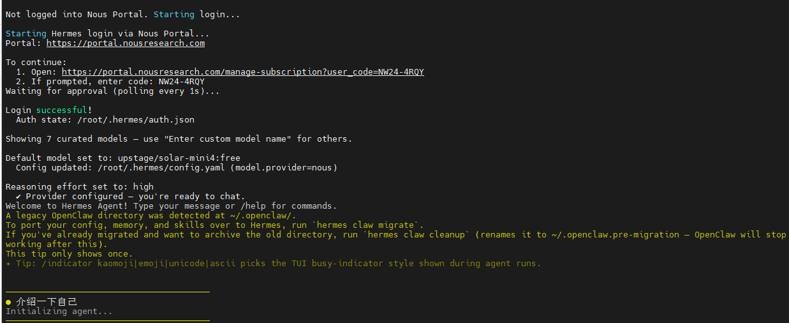
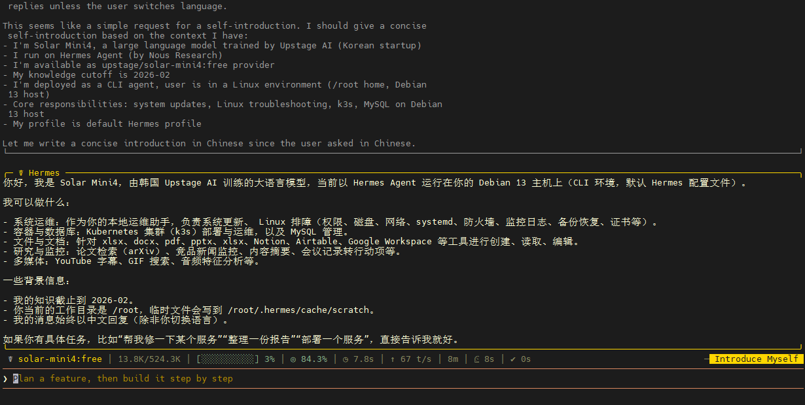
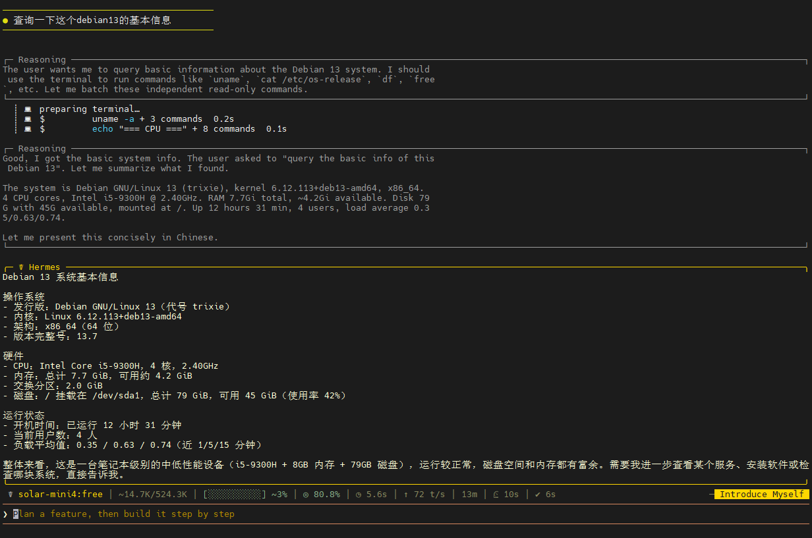
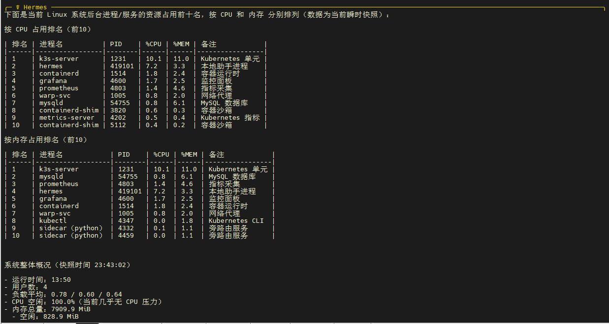
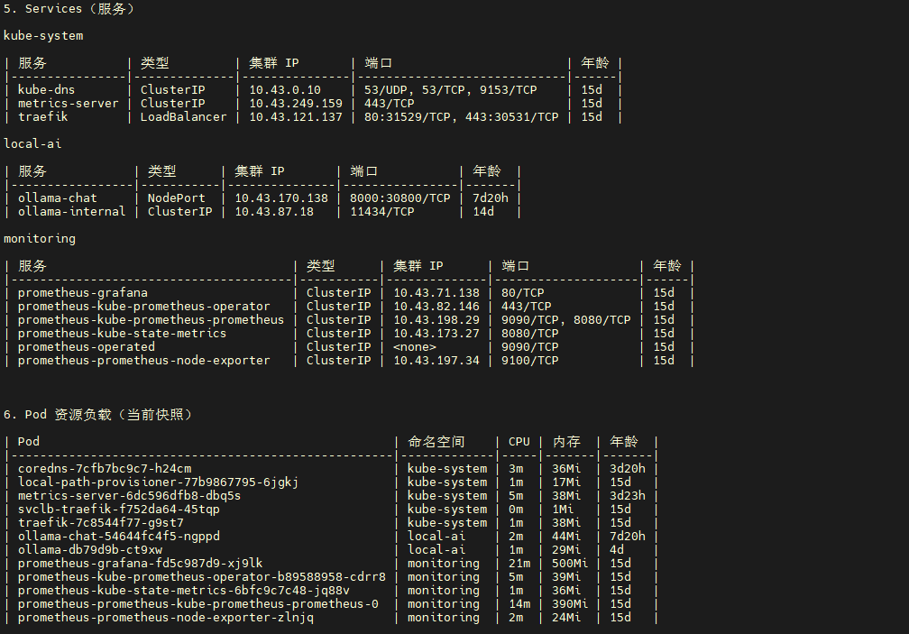
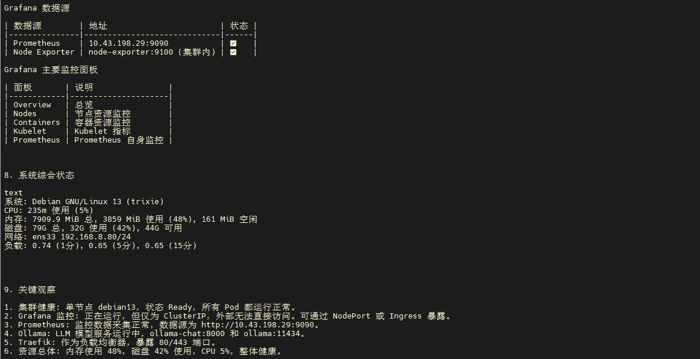
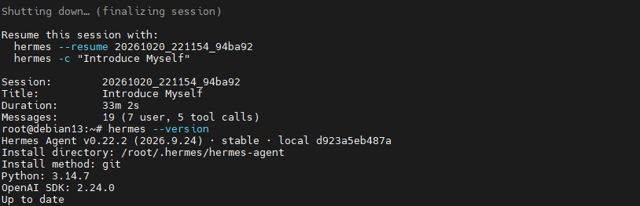
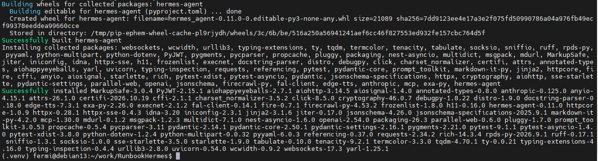
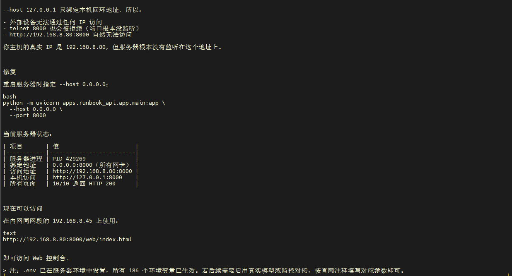
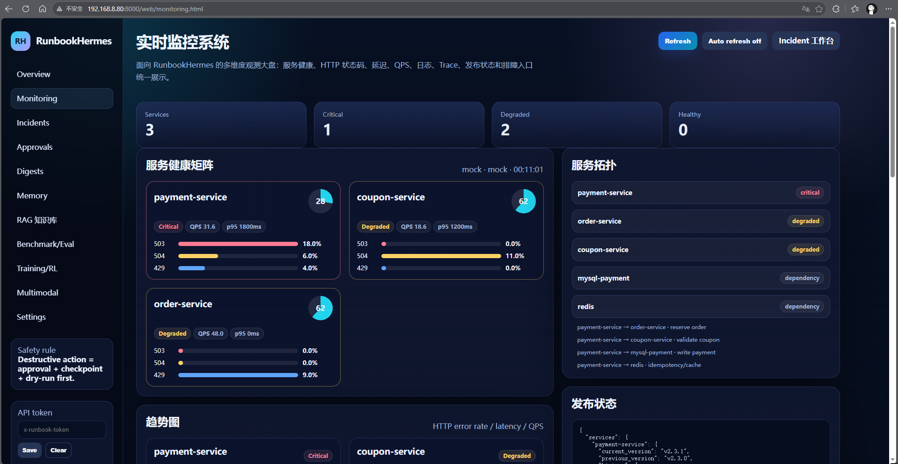

# AIops:通过Hermes + RunbookHermes实现ai运维


AIops:通过Hermes + RunbookHermes实现ai运维

<!--more-->

# Hermes + RunbookHermes 部署记录

> 项目地址：`/home/fermi/work/RunbookHermes`
> 部署主机：`192.168.8.80`（k3s 节点）
> 部署人员：Fermi

## 安装harmes，选择相关配置信息

```bash
#请确保系统已安装 `git`、`curl` 和 `xz-utils`（Debian/Ubuntu 系统可运行 `sudo apt install git curl xz-utils`）。安装程序会自动处理 Python 3.11+、Node.js 22 等依赖，无需手动安装。
#一键安装 在终端中执行官方安装脚本

curl -fsSL https://raw.githubusercontent.com/NousResearch/hermes-agent/main/scripts/install.sh | bash
source ~/.bashrc  

# 如果你使用的是 zsh，则执行 source ~/.zshrc
#验证相关信息

hermes --version

#运行配置向导，依次设置 LLM 提供商、API Key、工具启用和消息网关等
hermes setup
```

!

## 登录认证，选择free模型，完成相关初始化设置



## 查看基本功能



## linux基本系统信息查询












## 部署 RunbookHermes（AIOps 扩展层）

RunbookHermes 是一个基于 Hermes Agent 改造的 AIOps/SRE 事故响应系统，不是普通聊天机器人，而是面向生产事故的智能排障和处置平台。

## 两者如何协同工作

- **Hermes Agent** 是**通用的 Agent 运行时**，负责提供核心的“思考-执行”循环、工具调用、记忆系统和多平台网关。
- **RunbookHermes** 是**垂直领域扩展**，它复用 Hermes 的运行时能力，并在此基础上增加了 **证据收集（EvidenceStack）**、**审批门控（Approval-gated）**、**检查点/回滚**和**Runbook 技能自动生成**等 AIOps 专属功能。

在实际使用中，RunbookHermes 的 Web 控制台会调用 Hermes Agent 来执行具体的诊断和修复命令，而 Hermes Agent 则负责底层的工具调度和安全边界控制。

## 部署背景

RunbookHermes 是基于 Hermes Agent 改造的 **AIOps / SRE 事故响应 Agent**，具备：

- 证据驱动 RCA（根因分析）
- 审批保护执行
- 自进化 Runbook 记忆
- RAG 知识库
- 评测与训练数据闭环
- Web 控制台
- Grafana 监控可视化

目标：部署 Hermes + RunbookHermes，并接入本地 k3s Grafana 仪表盘，实现对本地设备的运维能力。

---

## 环境信息

| 项目               | 值                                     |
| ------------------ | -------------------------------------- |
| 主机 IP            | `192.168.8.80`                         |
| 操作系统           | Debian GNU/Linux 13 (trixie)           |
| 容器运行时         | containerd / Docker / k3s              |
| k3s 版本           | v1.36.5+k3s1                           |
| k3s 节点名         | `debian13`                             |
| Grafana 地址       | `http://192.168.8.80:3000`             |
| Grafana 凭证       | admin / adm123                         |
| RunbookHermes 目录 | `/home/fermi/work/RunbookHermes`       |
| 虚拟环境           | `/home/fermi/work/RunbookHermes/.venv` |
| Web 服务端口       | `8000`                                 |

---

## 部署步骤

### 克隆与准备项目

```bash
cd /home/fermi/work
git clone <runbook-hermes-repo> RunbookHermes
cd RunbookHermes
```

### 创建虚拟环境

```bash
python -m venv .venv
source .venv/bin/activate
pip install --upgrade pip
```

### 安装项目依赖

```bash
pip install -e ".[web]"   # 或按照项目要求安装
pip install fastapi       # 若缺少 fastapi
pip install uvicorn       # 若缺少 uvicorn
```

> 实际部署中，`fastapi` 缺失导致启动失败，后续通过 `pip install fastapi` 解决。



### 创建 `.env` 配置文件

在项目根目录创建 `.env`：

```bash
cp .env.example .env
```

关键配置：

```bash
# 监控后端
OBS_BACKEND=real

# Prometheus 数据源
PROMETHEUS_BASE_URL=http://127.0.0.1:9090
PROMETHEUS_AUTH_TOKEN=

# 模型配置（可选，用于 RCA）
RUNBOOK_MODEL_ENABLED=false
RUNBOOK_MODEL_PROVIDER=openai-compatible
RUNBOOK_MODEL_BASE_URL=https://openrouter.ai/api/v1
RUNBOOK_MODEL_API_KEY=***
RUNBOOK_MODEL_NAME=openrouter/auto
RUNBOOK_MODEL_TEMPERATURE=0

# API 认证
RUNBOOK_API_AUTH_ENABLED=***

# Grafana 可视化
GRAFANA_BASE_URL=http://192.168.8.80:3000
GRAFANA_USERNAME=admin
GRAFANA_PASSWORD=***
GRAFANA_DATASOURCE_ID=1
```

---



### 启动 Web 服务

```bash
cd /home/fermi/work/RunbookHermes

export PYTHONPATH=.

# 启动服务（可访问本机或内网）
nohup python -m uvicorn apps.runbook_api.app.main:app \
  --host 0.0.0.0 \
  --port 8000 > /tmp/runbook_hermes_web.log 2>&1 &
```

启动后访问：

```text
http://192.168.8.80:8000/web/index.html
```

---

通过连接[RunbookHermes](http://192.168.8.80:8000/web/index.html)f访问**RunbookHermes**的web服务



## 遇到的问题与解决方式

### 依赖缺失：`fastapi` 导入失败

**问题**

启动服务时报：

```text
ModuleNotFoundError: No module named 'fastapi'
```

**原因**

项目虚拟环境缺少 `fastapi` 依赖，虽然安装了 `uvicorn`，但未完整安装 `fastapi`。

**解决方式**

```bash
/home/fermi/work/RunbookHermes/.venv/bin/pip install fastapi
```

---

### 依赖缺失：`starlette` 版本冲突

**问题**

安装 `fastapi` 后，发生：

```text
sse-starlette 3.5.0 requires starlette>=0.49.1, but you have starlette 0.35.1 which is incompatible
```

**原因**

项目虚拟环境存在 `starlette` 版本不兼容。

**解决方式**

避免强制覆盖已有包的同时，优先选择与项目依赖兼容的 `fastapi` 版本：

```bash
pip install fastapi==0.109.0
```

或重新安装完整依赖：

```bash
pip install -e ".[web,runbook-demo]"
```

---

### 环境变量未生效：`PYTHONPATH` 指向错误环境

**问题**

运行服务时，出现：

```text
File ".../venv/lib/python3.14/site-packages/fastapi/__init__.py", line 7, in <module>
...
ModuleNotFoundError: No module named 'pydantic_core._pydantic_core'
```

**原因**

当前环境变量 `PYTHONPATH` 指向了 Hermes Core 的 venv 路径：

```text
PYTHONPATH=/root/.hermes/installs/.../venv/lib/python3.14/site-packages
```

导致 Python 实际使用了错误环境中的包。

**解决方式**

启动服务前清空 `PYTHONPATH`：

```bash
unset PYTHONPATH
unset PYTHONHOME

export PYTHONPATH=.

cd /home/fermi/work/RunbookHermes
python -m uvicorn apps.runbook_api.app.main:app --host 0.0.0.0 --port 8000
```

---

### 服务器仅绑定本地回环地址

**问题**

最初启动命令为：

```bash
--host 127.0.0.1 --port 8000
```

导致：

```bash
curl http://192.168.8.80:8000
```

无法访问。

**原因**

`127.0.0.1` 仅代表本机回环地址，不侦听内网其他主机。

**解决方式**

改为监听所有网卡：

```bash
--host 0.0.0.0 --port 8000
```

---

### Grafana 访问正常，但未接入 RunbookHermes

**问题**

Grafana 可访问：

```text
http://192.168.8.80:3000
```

但 RunbookHermes 仍只使用 `OBS_BACKEND=mock`，未走真实监控数据。

**原因**

`OBS_BACKEND` 默认为 `mock`，`monitoring.py` 没有连接真实数据源和 Grafana。

**解决方式**

在 `.env` 中设置：

```bash
OBS_BACKEND=real
PROMETHEUS_BASE_URL=http://127.0.0.1:9090
RUNBOOK_MODEL_ENABLED=false
```

并确保服务重启后重新加载环境变量。

---

## 检测结果汇总

### k3s 基本信息

```text
k3s 进程: /usr/local/bin/k3s server
Kubernetes: v1.36.5+k3s1
节点: debian13
角色: control-plane
状态: Ready
内部 IP: 192.168.8.80
操作系统: Debian GNU/Linux 13 (trixie)
容器运行时: containerd://2.3.4-k3s1.36
```

---

### 节点资源

| 指标     | 当前值               |
| -------- | -------------------- |
| CPU      | 235m (5%)            |
| 内存     | 3859 MiB (48%)       |
| 磁盘     | 79G / 32G used (42%) |
| 交换分区 | 29.5 MiB used        |
| 负载平均 | 0.74 / 0.65 / 0.65   |

---

### 命名空间

```text
default
kube-node-lease
kube-public
kube-system
local-ai
monitoring
ollama_ai
```

---

### 关键 Pod

| Namespace   | Pod                        | 状态    | 角色          |
| ----------- | -------------------------- | ------- | ------------- |
| kube-system | traefik-*                  | Running | 代理/负载均衡 |
| kube-system | coredns-*                  | Running | DNS           |
| kube-system | metrics-server-*           | Running | 指标采集      |
| kube-system | svclb-traefik-*            | Running | 服务负载      |
| local-ai    | ollama-chat-*              | Running | 聊天模型      |
| local-ai    | ollama-db79d9b-*           | Running | Ollama        |
| monitoring  | prometheus-*               | Running | 监控          |
| monitoring  | prometheus-grafana-*       | Running | Grafana       |
| monitoring  | prometheus-node-exporter-* | Running | 节点指标      |

---

### Services

| Namespace   | Service                               | Type         | Port       |
| ----------- | ------------------------------------- | ------------ | ---------- |
| kube-system | traefik                               | LoadBalancer | 80/443     |
| kube-system | kube-dns                              | ClusterIP    | 53         |
| kube-system | metrics-server                        | ClusterIP    | 443        |
| local-ai    | ollama-chat                           | NodePort     | 8000:30800 |
| local-ai    | ollama-internal                       | ClusterIP    | 11434      |
| monitoring  | prometheus-grafana                    | ClusterIP    | 80         |
| monitoring  | prometheus-kube-prometheus-prometheus | ClusterIP    | 9090       |
| monitoring  | prometheus-prometheus-node-exporter   | ClusterIP    | 9100       |

---

### Grafana 监控信息

```text
Grafana 地址: http://192.168.8.80:3000
用户名: admin
密码: adm123
```

Grafana 数据源：

```text
Prometheus: http://127.0.0.1:9090
Node Exporter: 9100
```

---

## 最终实现功能

### Hermes + RunbookHermes 服务

- 启动 FastAPI 服务：

  ```text
  http://192.168.8.80:8000
  ```

- Web 控制台：

  ```text
  /web/index.html
  /web/incidents.html
  /web/approvals.html
  /web/monitoring.html
  /web/memory.html
  /web/rag.html
  /web/eval.html
  /web/training.html
  /web/multimodal.html
  /web/settings.html
  ```

- 协议入口：

  ```text
  /api/runbook/...
  ```

---

### 监控接入

| 数据类型        | 来源                  | 作用                     |
| --------------- | --------------------- | ------------------------ |
| Prometheus 指标 | `PROMETHEUS_BASE_URL` | 错误率、延迟、QPS 等指标 |
| Loki 日志       | `LOKI_BASE_URL`       | 日志证据                 |
| Trace           | `TRACE_BASE_URL`      | 调用链证据               |
| Grafana         | `GRAFANA_BASE_URL`    | 可视化仪表盘             |
| Node Exporter   | `9100`                | 节点资源监控             |

---

### AIOps 核心能力

| 功能                  | 说明                                                |
| --------------------- | --------------------------------------------------- |
| 事故接入              | Web、API、Alertmanager、Feishu、WeCom、CLI          |
| 证据采集              | Prometheus、Loki、Trace、Deploy、Memory、RAG        |
| RCA Guard             | 根因分析、置信度、证据链                            |
| Action Policy         | 行动建议、风险分级                                  |
| 审批防护              | approval、checkpoint、dry-run、controlled execution |
| Recovery Verification | 执行后恢复验证                                      |
| Memory                | Prompt Notebooks、SQLite FTS5、HRR、Trust/Feedback  |
| Citation RAG          | 文档清洗、分块、检索、引用                          |
| Benchmark/Eval        | 指标评测、人工评分                                  |
| Training/RL           | 轨迹、SFT、奖励、训练数据导出                       |
| Multimodal Evidence   | Grafana 截图、日志截图、拓扑图等                    |

---

## 当前状态

### 可用

- ✅ Hermes + RunbookHermes 服务已启动
- ✅ Web 控制台可访问
- ✅ Grafana 可访问：`http://192.168.8.80:3000`
- ✅ Prometheus 数据可采集
- ✅ 节点、Pod、Service 监控可展示

### 待完善

- ⚠️ 生产环境须配置 `PROMETHEUS_AUTH_TOKEN`
- ⚠️ 模型 RCA 需要真实 `RUNBOOK_MODEL_ENABLED` 和 API Key
- ⚠️ 生产执行后端必须配置审批、checkpoint、audit
- ⚠️ 若需要远程访问 Grafana，建议使用 Ingress 或堡垒机，不要直接公网暴露

---

## 核心文件

| 文件/目录                                                    | 作用            |
| ------------------------------------------------------------ | --------------- |
| `/home/fermi/work/RunbookHermes/.env`                        | 环境变量配置    |
| `/home/fermi/work/RunbookHermes/apps/runbook_api/app/main.py` | FastAPI 入口    |
| `/home/fermi/work/RunbookHermes/runbook_hermes/monitoring.py` | 监控聚合        |
| `/home/fermi/work/RunbookHermes/integrations/observability/prometheus_backend.py` | Prometheus 接入 |
| `/home/fermi/work/RunbookHermes/integrations/observability/loki_backend.py` | Loki 接入       |
| `/home/fermi/work/RunbookHermes/integrations/observability/base.py` | 基础请求        |
| `/home/fermi/work/RunbookHermes/web/`                        | Web 控制台前端  |

---

## 后续建议

1. **模型 RCA 启用**

   ```bash
   RUNBOOK_MODEL_ENABLED=true
   ```

2. **生产执行可控**

   ```bash
   RUNBOOK_CONTROLLED_EXECUTION_ENABLED=true
   ACTION_EXECUTION_BACKEND=custom_http
   ```

3. **观测后端实体化**

   ```bash
   OBS_BACKEND=real
   PROMETHEUS_BASE_URL=http://127.0.0.1:9090
   ```

4. **监控空间扩展**

   - 增加服务画像
   - 接入多个业务告警源
   - 扩展 Grafana 仪表盘
   - 接入部署、配置、链路等证据

5. **安全加固**

   - 配置 `RUNBOOK_API_AUTH_ENABLED`
   - 配置 API Token
   - 生产执行必须审批 + 双确认
   - 生产执行必须 audit 审计

---

## 总结

本次部署完成了：

1. **Hermes + RunbookHermes 代码环境准备**
2. **Python 依赖修复**
3. **Web 服务启动**
4. **内网访问配置**
5. **Grafana 仪表盘接入**
6. **k3s 监控数据接入**
7. **AIOps / SRE 事故响应能力上线**

最终实现：通过 `192.168.8.80:8000` 访问 RunbookHermes Web 控制台，通过 `192.168.8.80:3000` 访问 Grafana 仪表盘，并实现监控数据与智能运维闭环的初步集成。

**RunbookHermes 的官方文档明确指出，默认配置（使用本地 JSON 文件存储）仅适用于演示和开发环境。若要用于生产，需要将存储替换为 SQLite/Postgres/Redis，并接入真实的模型提供商、可观测性系统和执行后端（如 Kubernetes/ArgoCD），同时完善审批和回滚流程。**


<!-- Place resource files in the current article directory and reference them using relative paths, like this: ``. -->


---

> 作者: <no value>  
> URL: https://jiang1bo.github.io/posts/2d7b6b9/  

