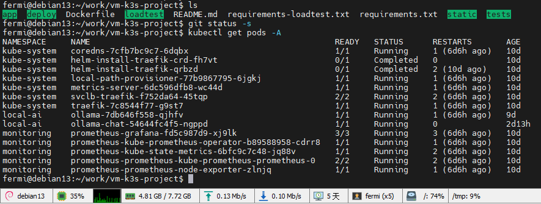
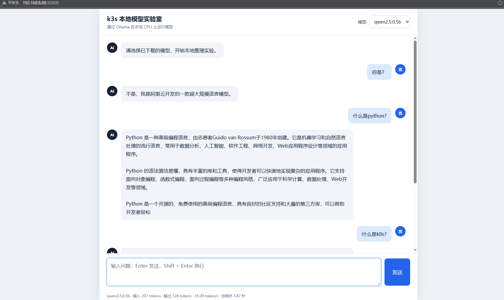
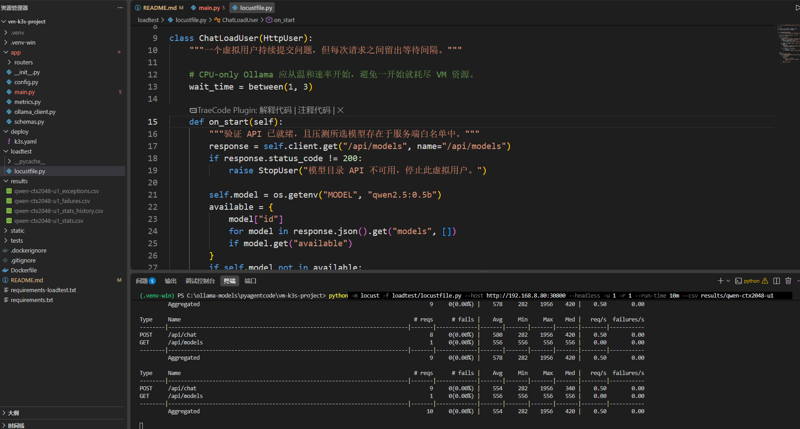
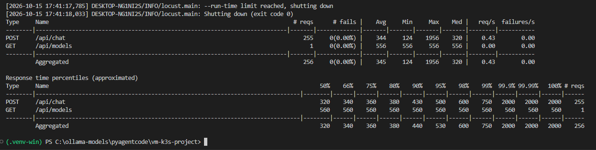
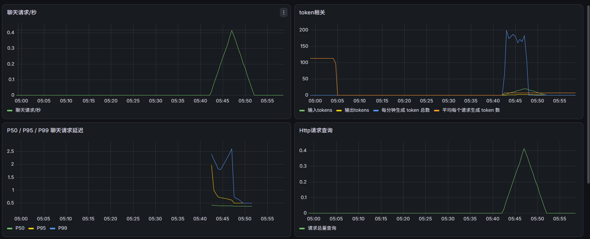
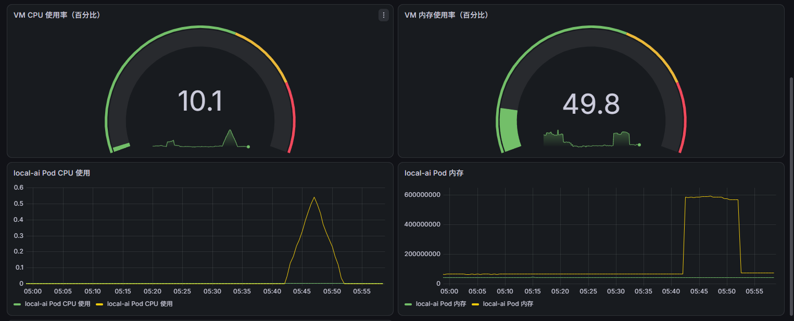
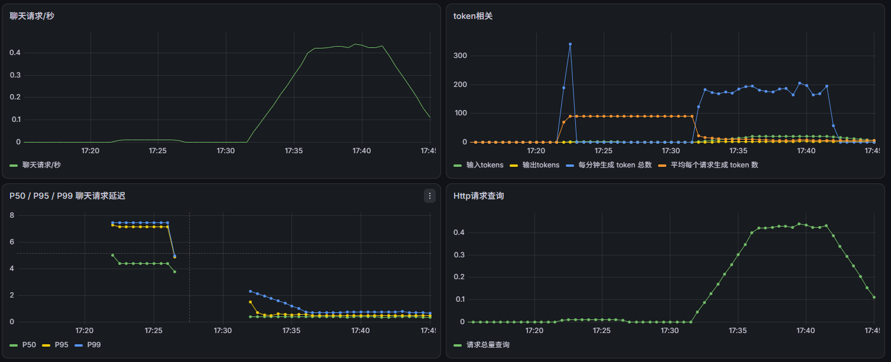
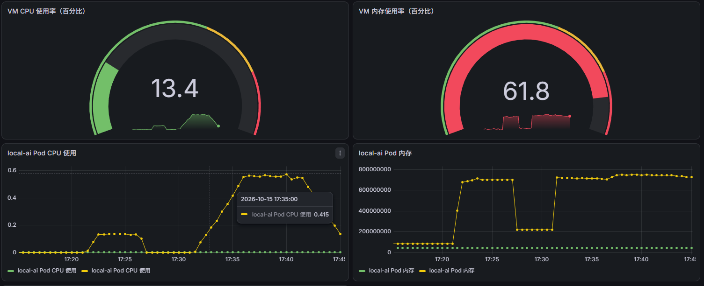

# 一套以 K3s + Ollama + Python Agent + Prometheus/Grafana 为核心的轻量 AI 运维治理平台


**一套以 K3s + Ollama + Python Agent + Prometheus/Grafana 为核心的轻量 AI 运维治理平台。**

<!--more-->

# k3s-ai 项目文档

**在低资源环境中，构建一套以 K3s + Ollama + Python Agent + Prometheus/Grafana 为核心的轻量 AI 运维治理平台，并逐步走向模型部署、知识库问答、工具调用、监控压测与发布回滚的完整闭环。**

**FastAPI Agent+locust相关代码已上传至仓库：**

https://github.com/jiang1bo/Fastapi-k3s-ollama

**Python Agent服务 + Prometheus/Grafana，通过Cloudflared 隧道开放至公网（不稳定，可能被墙打不开），后台演示访问地址：**

[k3s 本地模型实验室](https://ai.jiangbos.top/)

[ollama - Dashboards - Grafana](https://ga.jiangbos.top/d/ad7bb2l/ollama?from=now-6h&to=now&timezone=browser)

（user:fermi       pwd:654321）

## 1. 项目基本信息

| 项目         | 信息                                                         |
| ------------ | ------------------------------------------------------------ |
| 项目名称     | `vm-k3s-project`                                             |
| 项目定位     | 本地低资源环境下的 AI 运维与应用实验平台                     |
| 操作系统     | Debian 13 虚拟机，最小化安装，通过 SSH 管理                  |
| 虚拟机资源   | 4 vCPU、6 GB 内存、40 GB 磁盘                                |
| 虚拟化环境   | VMware 16，已启用嵌套虚拟化                                  |
| 宿主机记录   | Windows 10 Pro；Dell G3 3590，Intel i5-9300H、32 GB 内存、GTX 1650（4 GB 显存） |
| 虚拟机网络IP | `192.168.8.80`                                               |
| 核心技术栈   | K3s、Ollama、Python/FastAPI、Prometheus、Grafana             |

## 2. 项目目标

项目目标是在有限的计算与显存资源下，逐步构建轻量的 AI 运维平台，实现从模型服务到监控、性能分析和发布治理的实践闭环。

### 2.1 核心目标

- 在单节点 K3s 集群中运行轻量级本地模型和相关服务。
- 开发 Python/FastAPI Agent，支持运维知识问答和 Kubernetes 工具调用。
- 探索 PDF、Word、图片等资料解析，以及 RAG 知识库问答。
- 为应用提供 Prometheus 指标，接入 Grafana 进行可观测性分析。
- 逐步完善压测、资源调优、灰度发布和回滚能力。

### 2.2 模型方向

计划或试用的模型包括 Qwen、MiniCPM、Phi 等轻量模型。现在Ollama 中使用 `qwen2.5:0.5b`；其他模型属于候选或计划。

## 3. 项目进展

### 3.1 Debian 与 K3s 基础环境

Debian 13 虚拟机已安装并可通过 SSH 管理。历史记录包含 K3s 安装、镜像仓库配置、集群状态检查，以及为普通用户配置 `kubectl`。

**K3s 安装与镜像仓库配置：**

```bash
# 通过 Rancher 国内镜像脚本安装 K3s。
curl -sfL https://rancher-mirror.rancher.cn/k3s/k3s-install.sh \
  | INSTALL_K3S_MIRROR=cn sh -

# 配置容器镜像加速源，减轻默认镜像仓库访问受限的影响。
sudo mkdir -p /etc/rancher/k3s
sudo tee /etc/rancher/k3s/registries.yaml > /dev/null <<'EOF'
mirrors:
  docker.io:
    endpoint:
      - "https://docker.m.daocloud.io"
      - "https://dockerproxy.com"
      - "https://mirror.ccs.tencentyun.com"
      - "https://hub-mirror.c.163.com"
  registry.k8s.io:
    endpoint:
      - "https://registry.aliyuncs.com"
  ghcr.io:
    endpoint:
      - "https://ghcr.nju.edu.cn"
  quay.io:
    endpoint:
      - "https://quay.nju.edu.cn"
EOF

# 修改镜像配置后重启 K3s，使配置生效。
sudo systemctl restart k3s
```

> 镜像加速地址可能失效或调整，使用前应确认可用性，并遵循所在环境的安全策略。

**配置普通用户的集群访问：**

```bash
# 创建 kubectl 默认配置目录。
mkdir -p ~/.kube

# 将 K3s 管理配置复制给当前用户。
sudo cp /etc/rancher/k3s/k3s.yaml ~/.kube/config
sudo chown "$USER":"$USER" ~/.kube/config
chmod 600 ~/.kube/config

# 检查集群连接、节点和系统组件。
kubectl cluster-info
kubectl get nodes -o wide
kubectl get pods -A
```

现有集群节点为 `debian13`，状态为 `Ready`，CoreDNS、Traefik、local-path-provisioner 和 metrics-server 等组件已运行。

### 3.2 Prometheus 与 Grafana 监控栈

项目使用 Helm 部署 `kube-prometheus-stack` 到 `monitoring` 命名空间。现有记录包含 Prometheus、Grafana、kube-state-metrics、node-exporter 和 Prometheus Operator。

```bash
# 添加并更新 Prometheus 社区 Helm 仓库。
helm repo add prometheus-community \
  https://prometheus-community.github.io/helm-charts
helm repo update

# 创建监控命名空间。
kubectl create namespace monitoring

# 使用项目配置文件安装监控栈。
helm install prometheus prometheus-community/kube-prometheus-stack \
  -n monitoring \
  -f prom-values.yaml

# 后续配置变更使用 upgrade 更新已有 release。
helm upgrade prometheus prometheus-community/kube-prometheus-stack \
  -n monitoring \
  -f prom-values.yaml

# 检查监控组件状态与资源使用情况。
kubectl get pods -n monitoring -w
kubectl get svc -n monitoring
kubectl top pods -n monitoring
```

Grafana 的 Service 名称和端口可能会随 Helm release 或配置改变。应先查询 Service，再使用实际端口建立转发：

```bash
# 查询 Grafana Service 的真实名称和端口。
kubectl get svc -n monitoring

# 按查询结果替换 Service 名称及目标端口，再建立本地端口转发。
kubectl port-forward -n monitoring svc/<Grafana-Service> 3000:<Service-Port>
```

### 3.3 Ollama 与轻量模型

 Ollama 部署在 `local-ai` 命名空间，并使用 `ollama-internal` Service 和 `ollama-models` PVC；PVC 为 10 Gi 且状态为 `Bound`，以及模型 `qwen2.5:0.5b` 已安装。

通过 Kubernetes 清单部署 Ollama，并检查 PVC、Pod、Service 和模型状态：

```bash
# 部署 Ollama 及其相关 Kubernetes 资源。
kubectl apply -f ollama-k3s.yaml

# 检查 Pod、PVC 和 Service 是否创建。
kubectl -n local-ai get pods,pvc,svc

# 等待 Ollama Deployment 完成滚动部署，并查看 Pod 详情。
kubectl -n local-ai rollout status deployment/ollama
kubectl -n local-ai describe pod -l app=ollama

# 在 Ollama 容器中下载并检查轻量模型。
kubectl -n local-ai exec deployment/ollama -- \
  ollama pull qwen2.5:0.5b
kubectl -n local-ai exec deployment/ollama -- ollama list
```

模型服务的 API 曾通过本地端口转发进行检查。使用前需确认目标 Service 和转发状态：

```bash
# 将集群内 Ollama Service 转发到本机 11434 端口。
kubectl -n local-ai port-forward svc/ollama-internal 11434:11434

# 查询 Ollama 已加载或可用的模型。
curl -fsS http://127.0.0.1:11434/api/tags | python3 -m json.tool
```

### 3.4 FastAPI 聊天服务与本地镜像部署

构建 `k3s-ollama-chat` 镜像、将镜像导入 K3s containerd，以及部署 `deploy/k3s.yaml`应用为 Python/FastAPI 聊天服务。

```bash
# 在项目目录构建应用镜像；镜像名称和版本须与 Kubernetes 清单保持一致。
podman build --no-cache \
  -t localhost/k3s-ollama-chat:0.1.1 .

# 导出镜像，以便导入 K3s 使用的 containerd 镜像库。
podman save --format docker-archive \
  -o /tmp/k3s-ollama-chat-0.1.1.tar \
  localhost/k3s-ollama-chat:0.1.1

# 将镜像导入 K3s containerd。
sudo k3s ctr images import /tmp/k3s-ollama-chat-0.1.1.tar

# 应用部署清单并检查发布状态。
kubectl apply -f deploy/k3s.yaml
kubectl -n local-ai rollout status deployment/ollama-chat --timeout=5m

# 查看 Pod、ReplicaSet、Service 和 Endpoints，辅助定位部署问题。
kubectl -n local-ai get pods,rs,svc,endpoints -o wide
kubectl -n local-ai logs deployment/ollama-chat --tail=100
```

> 若使用本地导入的镜像，需确认 `deploy/k3s.yaml` 中镜像标签与构建标签一致，并检查 `imagePullPolicy`，避免集群仍尝试从远程仓库拉取镜像。

### 3.5 应用指标与监控接入

聊天服务 `/api/models` 和 `/metrics` 的请求，以及对 `ServiceMonitor`、Prometheus 和 Endpoints 的检查。应用可暴露指标供 Prometheus 抓取。

```bash
# 检查应用模型接口和 Prometheus 指标接口。
curl -fsS http://192.168.8.80:30800/api/models
curl -fsS http://192.168.8.80:30800/metrics \
  | grep -E 'llm_prompt_tokens_total|llm_generated_tokens_total'

# 检查应用 Service、Endpoints 和 ServiceMonitor。
kubectl -n local-ai get pods,svc,endpoints
kubectl -n local-ai get servicemonitor
kubectl -n local-ai describe servicemonitor ollama-chat

# 确认 Prometheus 实例存在，并观察工作负载资源使用情况。
kubectl -n monitoring get prometheus
kubectl top pods -n local-ai
```

## 4. 遇到的问题及解决方案

目前遇到的问题，以及解决方式

| 问题                                                         | 原因                                                         | 解决方案                                                     |
| ------------------------------------------------------------ | ------------------------------------------------------------ | ------------------------------------------------------------ |
| K3s 安装时镜像拉取超时                                       | 默认镜像源连接慢或受限，国内网络环境下拉取失败               | 历史记录中的处理办法是配置 `/etc/rancher/k3s/registries.yaml` 镜像源后重启 K3s； |
| `kubectl` 权限不足                                           | 普通用户读取 `/etc/rancher/k3s/k3s.yaml` 受限，或命令默认使用了错误的 kubeconfig | 将 kubeconfig 配置到 `~/.kube/config`，设置 `KUBECONFIG="$HOME/.kube/config"`。 |
| 无法保存 `prom-values.yaml`                                  | 文件或当前目录没有写入权限                                   | 在用户有权限的目录编辑，或使用 `sudo vim`。                  |
| Grafana 出现 `OOMKilled`                                     | Grafana 内存限制不足，VM 资源有限                            | 历史记录建议提高 Grafana 内存限制（曾提到 `1Gi`），并评估降低日志级别或关闭非必要组件。 |
| `kube-state-metrics` 镜像拉取失败                            | `registry.k8s.io` 网络不可达或受限                           | 可配置可用镜像源，或将镜像离线导入 K3s containerd；          |
| Grafana `port-forward` 报 `connection refused` / `broken pipe` | 历史诊断将连接中断与 Grafana Pod 被 OOM 杀死联系起来         | 先检查并恢复 Grafana Pod，再重新建立转发。若服务名或端口变化，先用 `kubectl -n monitoring get svc` 核实； |
| 忘记 Grafana 密码                                            | 密码保存在 Kubernetes Secret 中或默认密码已不清楚            | 可读取 `monitoring` 命名空间中的 Grafana Secret，或通过 Helm 更新密码。 |
| Prometheus 无法汉化                                          | Prometheus 原生 UI 没有对应的中文界面支持                    | 日常可使用已汉化的 Grafana 面板                              |
| 网页聊天对不同问题总是返回相同回答                           | 历史排查确认前端请求和后端调用正常，模型仍重复自我介绍；重复回答还可能被放入后续对话历史 | 建议给模型添加明确的系统指令、继续使用模型自带的 chat template，并检查模型与模板兼容性。 |
| RTX 1650 4 GB 显存无法完整加载较大模型                       | 原始 FP16 权重和推理开销超过显存；FastAPI 本身不提供 GPU 推理 | 使用合适的量化模型、控制上下文和 GPU 卸载层数，或让推理引擎在 GPU 与 CPU 间分配。 Debian VM 中运行的 Ollama 是 CPU 推理。 |
| Windows GPU 与 Debian K3s 的部署边界不清楚                   | VMware 里的 Linux VM 不会因为宿主机有 NVIDIA GPU 就自动获得 CUDA 能力 | 两种架构：Ollama 留在 Windows 使用显卡、Debian K3s 中的 FastAPI 通过网络调用它；或让 Ollama 留在 Debian VM 走 CPU 推理。选择哪种需与当前 Deployment 的 `OLLAMA_BASE_URL` 配置一致，并限制 Ollama API 的网络访问范围。 |
| WARP 导致 DNS 或域名解析异常                                 | 历史排查指向 WARP 与系统 DNS/IPv6 配置冲突                   | 整理建议断开 WARP 后检查并修复 `/etc/resolv.conf`；          |
| Ollama Pod 卡在 `ImagePullBackOff`                           | 镜像仓库网络或 DNS 问题，或镜像源不可用                      | 先检查 DNS 和镜像源，再尝试从可访问环境拉取并离线导入 K3s。现有 Ollama 曾成功运行并拉取模型。 |
| Ollama Pod 已运行但没有模型                                  | Ollama 服务健康不代表模型已下载；日志曾显示 `total blobs: 0` | 在 Pod 中执行 `ollama pull qwen2.5:0.5b` 并用 `ollama list` 确认。后续确认该模型曾安装在 PVC 中并通过 CPU 推理。 |
| FastAPI Pod `CrashLoopBackOff`                               | 镜像缺少应用导入的 `httpx`；同时还缺少提供 `/metrics` 所需的 `prometheus-client` | 建议将依赖加入 `requirements.txt`，用新镜像标签重新构建并导入，且保持镜像完整名称在 build、import 和 Deployment 中一致。是否已修复并部署成功，需检查当前 Pod 与镜像。 |
| FastAPI Pod 报 `ErrImageNeverPull`                           | Deployment 中的镜像名称/tag 与导入到 containerd 的镜像引用不一致 | 对齐镜像引用；使用新 tag 构建、导入并更新 Deployment，检查 Pod 事件和 endpoints。历史上曾同时出现镜像名不一致和依赖缺失这两个独立问题。 |
| ServiceMonitor 已配置但 Prometheus 抓不到 FastAPI 指标       | FastAPI Pod 不 Ready、Service 没有可用 endpoint 时，Prometheus 无法成功抓取 | 先确认 Pod Ready 和 Service endpoints，再核对 ServiceMonitor 标签与 Prometheus selector；历史清单的 `release: prometheus` 标签曾确认匹配， target UP 未确认。 |
| Ollama 没有 Prometheus `/metrics` 指标                       | Ollama 默认不一定提供项目需要的 Prometheus 指标              | 监控 FastAPI 暴露的请求与 token 指标；若需要 Ollama 自身指标，再评估 exporter。 |
| Debian 上 `python` 命令不存在                                | Debian 默认可能只安装 `python3` 命令                         | 使用 `python3`，或安装 `python-is-python3`。                 |
| SSH 密钥免密登录失败                                         | `~/.ssh` 或 `authorized_keys` 权限不符合 SSH 要求，或目标端未接受公钥 | 检查目录权限为 `700`、授权文件权限为 `600`，同时确认公钥已正确写入目标机。 |
| PowerShell 找不到 `locust` 命令                              | `requirements.txt` 是应用依赖，Locust 单独列在 `requirements-loadtest.txt`；当前 Python 环境中没有 Locust | 在 Windows 虚拟环境运行 `python -m pip install -r .\requirements-loadtest.txt`，再用 `python -m locust ...` 启动。 |
| PowerShell 中 Locust 命令的 `\` 换行写法异常                 | `\` 是 Unix shell 常见续行方式，不是 PowerShell 的续行符     | 在 PowerShell 中将命令写成一行，或使用反引号 ``` 续行。      |
| Locust CSV 输出路径可能无法创建                              | `--csv` 参数是文件名前缀，输出目录必须存在                   | 先创建 `results` 目录，再执行压测。当前 Windows 副本已存在 `results/`，并有一组 CSV 结果。 |
| 监控面板不能从本机浏览器直接访问                             | Grafana 在 Debian K3s 集群内，本机没有直接建立到服务端口的通道 | 用 SSH 隧道把 Grafana Service 转发到本机 `127.0.0.1:3000`，浏览器访问该地址。 |
| Grafana SSH 转发没有开机/登录后自动启动                      | 手动运行的 SSH 隧道会随终端关闭而中断                        | 先确认 SSH 密钥可无交互登录，再通过 Windows 任务计划程序配置“用户登录时”运行隧道脚本，并设置失败重试。 |

**总体判断：** 许多问题已有明确诊断和操作方案；部分基础组件（K3s、监控栈、Ollama、小模型）亦验证可用。FastAPI 当前部署、Windows Locust 依赖安装、Prometheus 实际抓取以及 Grafana 自动转发均需要，再次确认。

## 5. 当前状态总结

### 已完成的工作

- Debian 13 虚拟机和 SSH 管理环境已建立。
- K3s 单节点集群已部署；现有文档记录节点状态为 `Ready`。
- 已配置普通用户的 `kubectl` 访问方式。
- 已通过 Helm 部署 Prometheus/Grafana 监控栈。
- 已有 Ollama、`local-ai` 命名空间、PVC 和轻量模型的部署记录。
- 已推进 FastAPI 聊天服务的镜像构建、K3s 导入和 Kubernetes 部署。
- 已为应用提供 `/metrics`，并记录了配置 `ServiceMonitor` 和检查 Prometheus 抓取状态的操作。

### 后续需要进一步优化的事项

- Ollama、聊天服务、Prometheus 和 Grafana 当前是否都处于健康运行状态。
- 应用 ServiceMonitor 是否已被 Prometheus 发现，指标是否持续进入时序数据库。
- WARP、DNS 和容器镜像仓库访问问题是否仍会影响部署。
- Grafana 和其他服务是否仍存在内存不足或 OOM 问题。
- 当前 Git 分支、远程默认分支与项目目录状态。

**整体判断: 项目已从基础设施搭建阶段推进到本地模型服务、应用部署和可观测性集成阶段。当前重点应从“继续安装组件”转为核实现有服务的运行状态、指标链路和资源占用，再开展 RAG、Agent 工具调用与压测工作。**

## 6. 后续计划

1. 先建立运行状态基线：检查节点、工作负载、事件、资源使用、PVC 和 Service/Endpoints。
2. 推进 RAG 原型：选择适合 6 GB 虚拟机的轻量方案，完成文档解析、向量检索和知识问答验证。
3. 开发 Agent 工具调用：先实现只读的 Kubernetes 查询能力，再逐步增加任务规划和受控操作。
4. 执行压测与优化：使用 Locust 等工具测量响应时间、吞吐量和资源占用，定位瓶颈。
5. 探索发布治理：在基础服务稳定后，再评估 Argo Rollouts、灰度发布和自动回滚。

**建议状态核验的命令：**

```bash
# 检查节点和所有命名空间中的工作负载。
kubectl get nodes -o wide
kubectl get pods -A

# 检查近期事件，优先关注拉取失败、调度失败和容器重启。
kubectl get events -A --sort-by=.metadata.creationTimestamp

# 检查 Ollama 与聊天服务的资源、PVC 和网络端点。
kubectl -n local-ai get deployment,pods,svc,endpoints,pvc -o wide
kubectl top pods -n local-ai

# 检查监控组件及 ServiceMonitor。
kubectl -n monitoring get pods,svc,prometheus
kubectl -n local-ai get servicemonitor
```

## 7. 一句话项目概括

该项目的总体方向是：在本地低资源环境中，构建一套以 K3s + Ollama + Python Agent + Prometheus/Grafana 为核心的轻量 AI 运维治理平台，并逐步走向模型部署、知识库问答、工具调用、监控压测与发布回滚的完整闭环。

## 8. 项目成果

### ollama本地模型+FastAPI 聊天服务

```bash
fermi@debian13:~/work/vm-k3s-project$ git status -s
fermi@debian13:~/work/vm-k3s-project$ kubectl get pods -A
NAMESPACE     NAME                                                  READY   STATUS      RESTARTS       AGE
kube-system   coredns-7cfb7bc9c7-6dqbx                              1/1     Running     1 (6d6h ago)   10d
kube-system   helm-install-traefik-crd-fh7vt                        0/1     Completed   0              10d
kube-system   helm-install-traefik-qrbzd                            0/1     Completed   2 (10d ago)    10d
kube-system   local-path-provisioner-77b9867795-6jgkj               1/1     Running     1 (6d6h ago)   10d
kube-system   metrics-server-6dc596dfb8-wc44d                       1/1     Running     1 (6d6h ago)   10d
kube-system   svclb-traefik-f752da64-45tqp                          2/2     Running     2 (6d6h ago)   10d
kube-system   traefik-7c8544f77-g9st7                               1/1     Running     1 (6d6h ago)   10d
local-ai      ollama-7db646f558-qjhfv                               1/1     Running     1 (6d6h ago)   9d
local-ai      ollama-chat-54644fc4f5-ngppd                          1/1     Running     0              2d13h
monitoring    prometheus-grafana-fd5c987d9-xj9lk                    3/3     Running     3 (6d6h ago)   10d
monitoring    prometheus-kube-prometheus-operator-b89588958-cdrr8   1/1     Running     1 (6d6h ago)   10d
monitoring    prometheus-kube-state-metrics-6bfc9c7c48-jq88v        1/1     Running     2 (6d6h ago)   10d
monitoring    prometheus-prometheus-kube-prometheus-prometheus-0    2/2     Running     2 (6d6h ago)   10d
monitoring    prometheus-prometheus-node-exporter-zlnjq             1/1     Running     1 (6d6h ago)   10d
fermi@debian13:~/work/vm-k3s-project$
```






### 使用 Locust 模拟短问答请求，进行压测

| 参数                               | 作用                                                         |
| ---------------------------------- | ------------------------------------------------------------ |
| `python -m locust`                 | 用当前 Python 环境运行 Locust，确保使用已安装 Locust 的虚拟环境 |
| `-f loadtest/locustfile.py`        | 指定压测脚本；其中定义了用户行为和请求                       |
| `--host http://192.168.8.80:30800` | 设置服务基地址，脚本中的请求会发往这个地址                   |
| `--headless`                       | 无图形界面运行，不启动 Locust 网页控制台                     |
| `-u 1`                             | 模拟 1 个并发虚拟用户                                        |
| `-r 1`                             | 每秒启动 1 个虚拟用户；这里从 0 到 1 个用户大约 1 秒         |
| `--run-time 5m`                    | 压测运行 5 分钟后自动停止                                    |
| `--csv results/qwen-ctx2048-u1`    | 将统计结果保存到以此前缀命名的 CSV 文件中，便于之后查看或比较 |

注意：`--csv` 后面是**文件名前缀**，不是单个文件名。`results` 文件夹需要预先存在；如果还没有，可以先运行：

```powershell
New-Item -ItemType Directory -Force results
```

压测用户数量和速度分别由 `-u`、`-r` 控制；当前配置适合先做单用户基线测试，不代表高并发压测。

```python
python -m locust -f loadtest/locustfile.py --host http://192.168.8.80:30800 --headless -u 1 -r 1 --run-time 5m --csv results/qwen-ctx2048-u1
```

这条命令会用 Locust 对 `http://192.168.8.80:30800` 运行 **5 分钟、1 个虚拟用户**的无界面压测，并把结果保存为 CSV 文件。





### 应用指标与监控接入

#### Locust 模拟压测启动前

**每秒聊天请求，token输入输出，p50,p95,p99监控指标，http和请求错误监控**


 **debian13系统负载,k3spodcpu+内存开销监控**



#### Locust 模拟压测启动后

**每秒聊天请求，token输入输出，p50,p95,p99监控指标，http和请求错误监控**



**debian13系统负载,k3s运行pods CPU+内存 开销监控**




<!-- Place resource files in the current article directory and reference them using relative paths, like this: ``. -->


---

> 作者: <no value>  
> URL: https://jiang1bo.github.io/posts/33c6be5/  

