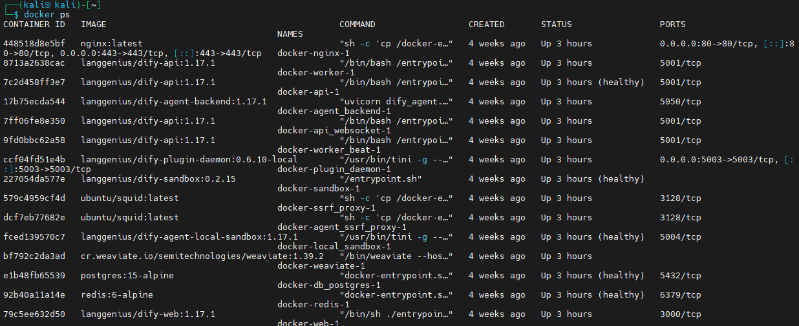
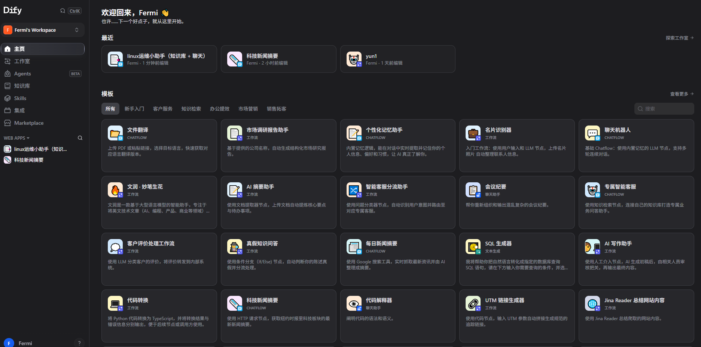
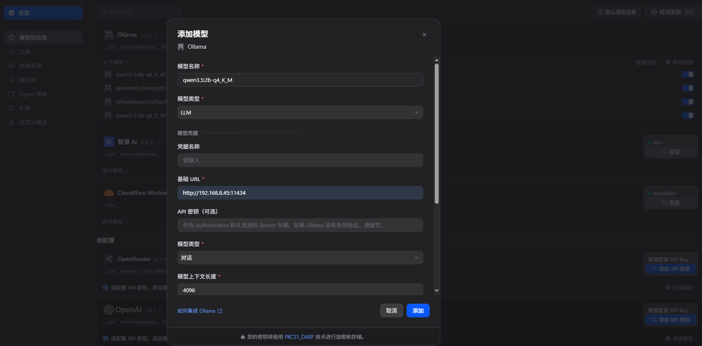
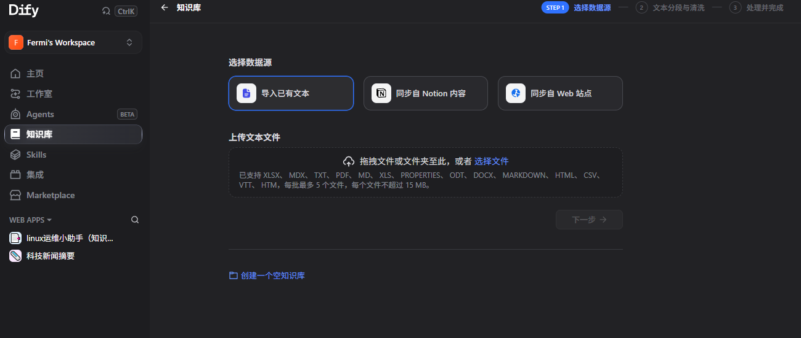
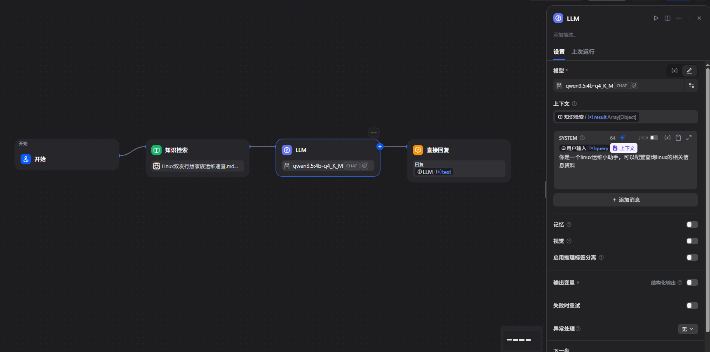
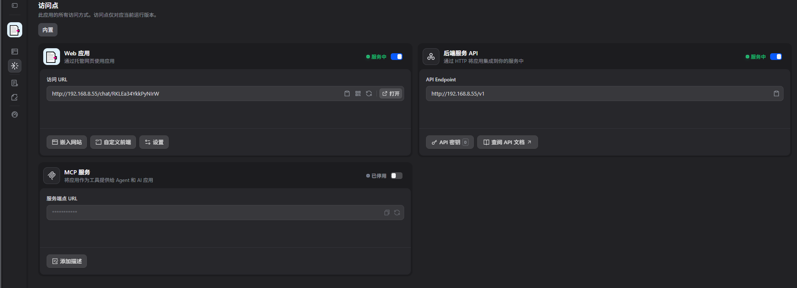
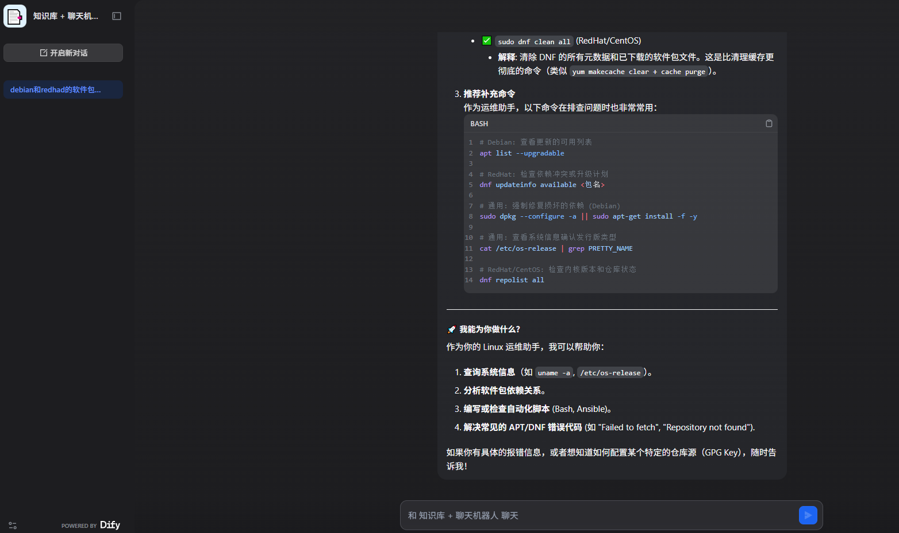

# Dify搭建本地知识库


在本地 Linux 上部署 Dify 并搭建知识库问答系统。

<!--more-->

用 Docker Compose 快速部署 Dify 平台，再通过可视化界面配置模型、创建知识库并关联到问答应用中。

### 第一步：部署 Dify 平台（Docker Compose 方式）

这是官方推荐的快速部署方式，适合大多数场景。

**1. 环境准备**
确保你的 Linux 系统满足最低要求：

*   **硬件**：CPU ≥ 2 核，RAM ≥ 4 GiB。
*   **软件**：Docker 19.03+，Docker Compose 2.24.0+（官方快速部署推荐版本）。

**2. 克隆 Dify 源码**

```bash
git clone https://github.com/langgenius/dify.git
cd dify/docker
```


**3. 配置环境变量**
复制示例配置文件，后续可按需修改端口等参数。
```bash
cp .env.example .env
```

**4. 启动容器**

```bash
docker compose up -d
```
该命令会启动**7 个核心服务**（api, worker, web 等）、**8 个依赖组件**（PostgreSQL, Redis, Weaviate 等）以及一个一次性的权限初始化任务。



**5. 验证并访问**

*   运行 `docker compose ps`，确认所有容器状态为 `Up` 或 `healthy`。
*   在浏览器访问 `http://你的服务器IP`，即可进入 Dify 的安装引导页面，设置管理员账号密码后即可登录。



---

### 第二步：搭建知识库问答系统

登录 Dify 后，按以下流程操作：

#### 1. 配置模型供应商（提供“大脑”）
在 **设置 → 模型供应商** 中，安装并配置你需要使用的大模型。
*   **商业模型**：如 OpenAI、DeepSeek、通义千问等，通常只需填入对应的 **API Key** 即可。
*   **本地模型**（本次使用）：如果你用 Ollama 等工具在本地运行模型，需在 Dify 中配置**自定义端点 URL**。以及填写相关配置信息



#### 2. 创建知识库（准备“资料”）
进入 **知识库** 菜单，点击 **创建知识库**，开始上传你的专业文档（PDF、Word、TXT等）。

**关键环节：文本分段与清洗**
这是决定检索质量的核心步骤，AI 并非阅读整篇文档，而是搜索最相关的“文本片段”。

*   **分段模式**：**通用分段**最常用，按指定长度均匀切分；**父子分段**则更精细，父块提供上下文，子块用于精准匹配。
*   **参数建议**：一个常见的起点是，将 **“分段最大长度”设为 600**，**“分段重叠长度”设为 100**，你可以根据文档类型和预览效果进行调整。



#### 3. 创建问答应用（组装“系统”）
进入 **工作室**，创建 **聊天助手** 类型的应用。

这里使用了4个组件，一个开始（用户输入），一个知识检索（添加知识库），一个llm(ai进行判断思考)，一个直接回复（负责显示ai输出信息）

每个组件的输入都是上一个组件的输出，需要添加一下上下文信息，输入知识检索。将大模型输出作为下一个节点的输入。

```bash

{{#sys.query#}}{{#context#}}
你是一个linux运维小助手，可以配置查询linux的相关信息资料

```

**关联知识库并配置检索策略**
在应用的 **上下文设置** 中添加刚创建的知识库，并配置**召回策略**，这直接决定了回答的准确性。

| 配置项          | 说明与建议                                                   |
| :-------------- | :----------------------------------------------------------- |
| **检索模式**    | 推荐 **混合检索（Hybrid Search）**，即向量检索（语义相似）+ 关键词检索（BM25，精确匹配）的结合，召回率显著优于单一模式。 |
| **Rerank 模型** | 混合检索后，使用 Rerank 模型对结果进行**重排序**，能进一步筛选出最相关的内容，提升回答精度。可选用 `bge-reranker-v2-m3` 等模型。 |
| **Top K**       | 控制检索返回的文本片段数量。建议**粗召回时设为 10~20**，再通过 Rerank 精排压缩至 **3~5** 条作为最终上下文。 |
| **Score 阈值**  | 过滤低质量片段的相似度分数门槛，默认约 0.5，可按需提高以获取更精确的结果。 |



配置完成后，**保存并发布**应用，即可通过网页或 API 进行问答交互。





---

### 常见问题与排查

*   **端口冲突（80 端口被占用）**：修改 `dify/docker/.env` 文件中的 `EXPOSE_NGINX_PORT` 变量，将其改为其他端口（如 8080）。
*   **Docker 容器无法访问宿主机服务**：**不要使用 `127.0.0.1`**。在模型供应商的端点配置中，使用宿主机的**局域网 IP 地址**（例如 `http://192.168.1.100:11434`）。
*   **镜像拉取失败或超时**：可为 Docker 配置国内镜像加速器，在 `/etc/docker/daemon.json` 中添加 `registry-mirrors` 配置。

总的来说，Docker Compose 负责“跑起来”，模型供应商决定“脑力”，知识库的分段与检索策略则决定了“检索准不准”。你可以先用少量文档和默认参数跑通流程，再逐步优化分段和召回参数来提升效果。


<!-- Place resource files in the current article directory and reference them using relative paths, like this: ``. -->


 


---

> 作者: <no value>  
> URL: https://jiang1bo.github.io/posts/a6795ff/  

